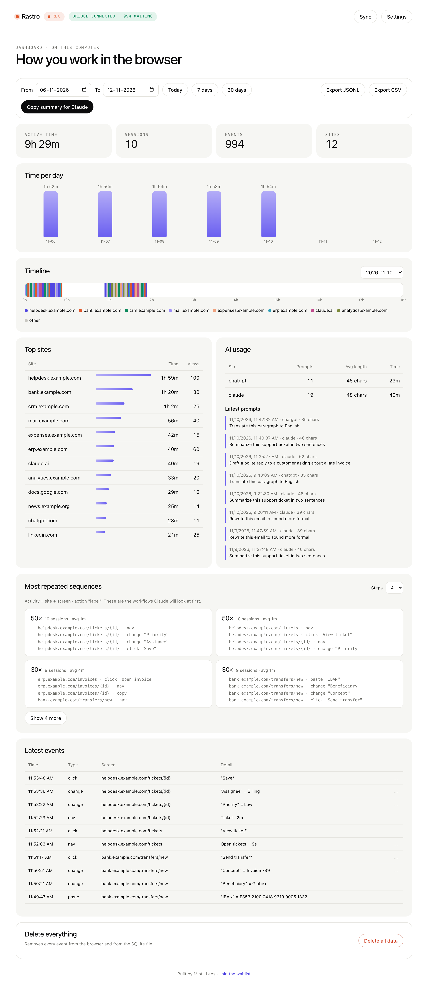
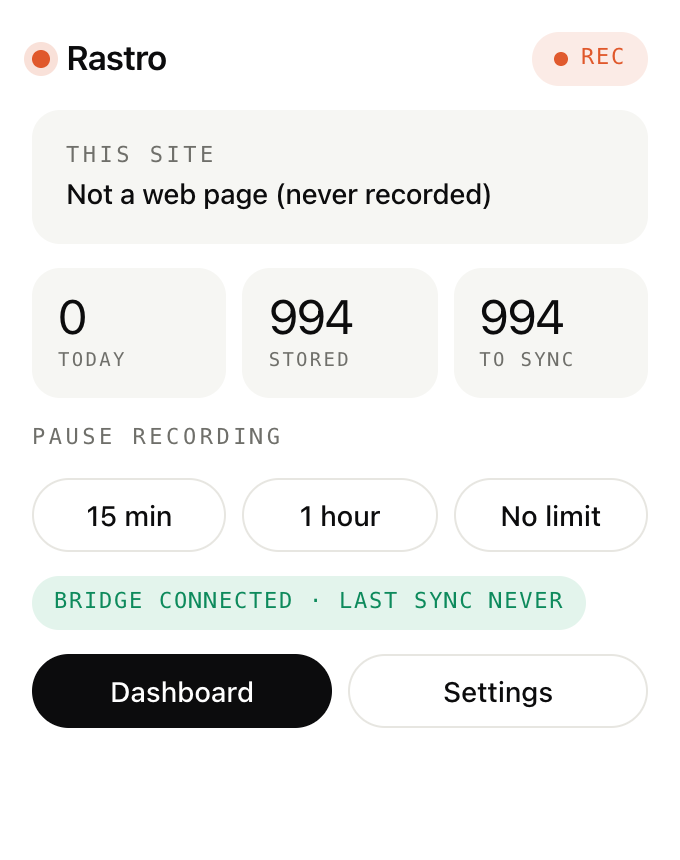

# Spoor

[](https://github.com/martinpmm/spoor/actions/workflows/ci.yml)
[](LICENSE)

Open source browser recorder for process discovery. Local only, connected to Claude through a local MCP server.

Spoor records how work happens in the browser (sites, steps, typed values, time, AI usage), stores everything on your own machine, and lets you ask your own Claude which workflows repeat and which ones are worth automating.

Built by [Mintii Labs](https://mintiilabs.com). **[Join the waitlist](https://mintiilabs.com/waitlist)** to hear what we build next.



> **Status:** early (v0.1). Recording, the bridge and the MCP server work and are tested; expect rough edges, especially in the AI site adapters.

> **Use rule.** Spoor records everything a person does in the browser, including what they type. Install it only on your own browser, or with the informed consent of the person who uses that browser.

## What it records

- Sites and screens, as URL templates (`/invoices/{id}/edit`), with page titles and time spent
- Clicks, form submits, copy and paste (first 200 characters), file uploads (file names only)
- **The final value typed into each field** (up to 1000 characters, once per field, not each keystroke)
- Prompts sent to ChatGPT, Claude, Gemini and Copilot, with their text
- Focus, idle and active periods, grouped into sessions

## What it never records

- Password fields, and fields marked as password, card data (`cc-*`) or one time code
- Hidden inputs, and fields named or labelled password, passcode, PIN, CVV, secret, token, contraseña, clave… (full list in [`sensitive.ts`](extension/lib/sensitive.ts))
- Anything in incognito windows
- Screenshots, page content, file contents

A sensitive field produces no event at all, not even a click or a paste. Details and known limits: [docs/PRIVACY.md](docs/PRIVACY.md).

## How it works

```
browser events
   > background worker and content script
   > IndexedDB (dashboard, export, buffer)
   > native messaging > bridge > ~/.spoor/events.db (SQLite)
                                   > MCP server (read only) > Claude Desktop or Claude Code
```

- **Extension** (WXT, TypeScript, Manifest V3; Chrome, Edge, Brave): records, shows the dashboard, forwards batches to the bridge.
- **Bridge** (Node): Chrome starts it through native messaging. It writes to SQLite. No open port, nothing listening on the network.
- **MCP server** (same Node package): Claude starts it over stdio. It opens the SQLite file read only.

The extension and the bridge make zero network requests. No server, no account, no telemetry. If the bridge is missing, the extension keeps everything in IndexedDB and sends the backlog when the bridge appears.

## Install

You need Node 22.13 or newer and a Chromium browser (Chrome, Edge, Brave or Chromium).

1. Clone and build:

   ```bash
   git clone https://github.com/martinpmm/spoor.git
   cd spoor
   npm install
   npm run build
   ```

2. Register the bridge (writes the native messaging manifest for every Chromium browser it finds, allowing only the Spoor extension ID):

   ```bash
   npm run register
   ```

   It prints the Claude configuration block for your machine; keep it for step 4.

3. Load the extension: open `chrome://extensions` (or `edge://extensions`, `brave://extensions`), turn on **Developer mode**, click **Load unpacked** and pick the `extension/dist/chrome-mv3` folder (created by `npm run build`).
   (Or unzip `spoor-extension-x.y.z.zip` from a GitHub release and load that folder.)
   The onboarding page opens. The toolbar badge shows **REC**.

4. Open the extension's **Settings**: it says **Bridge connected** once the first batch is stored. Then connect Claude: see [docs/CLAUDE_SETUP.md](docs/CLAUDE_SETUP.md). In short, for Claude Code:

   ```bash
   claude mcp add spoor --scope user -- node --no-warnings /absolute/path/to/spoor/bridge/dist/mcp.js
   ```

   For Claude Desktop, paste the block printed by `npm run register` into Settings → Developer → Edit Config, and restart it.

The extension ID is fixed by the `key` in the manifest: `nfdcncheigkogigcjnjpinbmfoibebme`.

## Use it

|                                      |                                                                                                                                                                                                                                                                                                                                                                                                                                                                                                                                                                                                                              |
| ------------------------------------ | ---------------------------------------------------------------------------------------------------------------------------------------------------------------------------------------------------------------------------------------------------------------------------------------------------------------------------------------------------------------------------------------------------------------------------------------------------------------------------------------------------------------------------------------------------------------------------------------------------------------------------- |
|  | **Toolbar button**: REC/OFF, events today, pause 15 minutes / 1 hour / no limit, exclude this site, bridge status. <br><br> **Dashboard**: active time, time per day, a timeline per day, top sites, AI usage (with a warning when an AI adapter breaks), the most repeated sequences, latest events, **Export JSONL / CSV** for a date range, **Copy summary for Claude**, delete all. <br><br> **Settings**: all sites / all except a list / only a list, record typed values, record AI prompt text, **Let Claude read typed values**, URL query keys to keep, retention (30 days by default), bridge status, delete all. |

Then ask Claude (or run the bundled prompt `find_automation_opportunities`):

- "What are my five most repeated workflows this week and how long does each take?"
- "Between which two systems do I copy and paste the most, and what data moves?"
- "Which fields do I fill in by hand with the same kind of value every day?"
- "What do I use AI tools for, and which of those requests repeat?"
- "Which workflow would you automate first and why?"

MCP tools (all read only): `get_overview`, `list_sessions`, `get_session`, `top_sequences`, `site_switches`, `field_values`, `ai_usage`, `search_events`, `export_jsonl`.

### With an AI agent on your computer: the Spoor skill

If you use an AI agent locally, such as Claude Code or Claude Desktop, combine your prompt with the bundled skill, [skills/spoor-workflows](skills/spoor-workflows/SKILL.md). It turns any question about your work into a full review:

- **Repetitive tasks**: repeated sequences, named as workflows and ranked by the time they take each week.
- **And more**: data you copy by hand between systems, fields you fill in with the same kind of value, and AI prompts you send again and again.
- **Memory**: before it starts, it reads what your agent already remembers about your work (earlier reviews, what you automated, what you chose to ignore). After it reports, it offers to save a short summary to your agent's memory, so the next review says what is new, what grew and what disappeared. It saves workflow names and counts only, never typed values or prompt text.

Install it in Claude Code (from the root of this repository):

```bash
mkdir -p ~/.claude/skills && cp -r skills/spoor-workflows ~/.claude/skills/
```

Then ask as usual ("What should I automate this week?") or run `/spoor-workflows`. For Claude Desktop, zip the `skills/spoor-workflows` folder and add it as a custom skill in Claude's settings. Other agents that read `SKILL.md` files can load the same folder. The skill needs the Spoor MCP server connected: see [docs/CLAUDE_SETUP.md](docs/CLAUDE_SETUP.md).

### Try it before recording: demo data

```bash
npm run demo -w bridge
```

Writes a synthetic week with five known workflows to `~/.spoor-demo/events.db` and prints a `spoor-demo` server entry for Claude. Ask "Use spoor-demo. What were my five most repeated workflows last week?" and compare with the list at the top of [`bridge/src/demo.ts`](bridge/src/demo.ts).

### Process map (optional)

```bash
pip install -r analysis/requirements.txt     # optional, pm4py
python analysis/process_map.py spoor-export.jsonl --out map --csv log.csv
```

Draws a directly-follows map from a JSONL export (or prints transitions and writes a Graphviz `.dot` without pm4py). `--csv` writes an event log for pm4py, Disco or Celonis.

## Data and privacy

- IndexedDB in the extension, and `~/.spoor/events.db` (folder `0700`, file `0600`) when the bridge is installed. Not encrypted.
- Retention: 30 days by default, cleaned daily in both stores. **Delete all data** empties both.
- When you ask Claude a question, the results of the tools it calls become part of that conversation, including typed values and prompt text. Turn off **Let Claude read typed values** to share only lengths.

## Troubleshooting

- **"Bridge not connected"** in settings
  - Did `npm run build` and `npm run register` run without errors? `npm run register` lists the manifests it wrote.
  - "Specified native messaging host not found": the browser did not find the manifest. Run `npm run register` again after installing the browser; for a custom profile folder use `npm run register -- --target-dir "<profile>/NativeMessagingHosts"`.
  - "Access to the specified native messaging host is forbidden": the extension ID differs (for example a dev build). Use `npm run register -- --extension-id <id shown in settings>`.
  - The bridge writes errors to `~/.spoor/bridge.log`.
  - Click **Reconnect**. Nothing is lost while disconnected.
- **Moved the repository or changed Node version**: run `npm run register` again (the manifest stores absolute paths).
- **Changed permissions in the manifest**: reloading is not enough; remove the extension and load it again.
- **An AI site stopped being recorded**: the dashboard shows which adapter needs an update. See [CONTRIBUTING.md](CONTRIBUTING.md#how-to-fix-an-adapter).

## Uninstall

Remove the extension from `chrome://extensions` (deletes IndexedDB), then:

```bash
npm run unregister -w bridge   # removes the native host manifests
rm -rf ~/.spoor               # removes the SQLite file
```

## Development

```bash
npm test               # unit tests (Vitest), bridge and extension
npm run test:e2e       # Playwright: extension + fixture app + real bridge + SQLite
npm run lint && npm run format:check && npm run typecheck
npm run dev -w extension   # WXT dev mode with hot reload
npm run fixture            # the fake InvoiceApp used by the e2e test, on :4321
npm run inspect -w bridge  # MCP Inspector
```

Repository layout, adapter fixes, schema changes and the release checklist: [CONTRIBUTING.md](CONTRIBUTING.md). Event schema: [docs/EVENT_SCHEMA.md](docs/EVENT_SCHEMA.md).

## Contributing

Issues and pull requests are welcome. The easiest place to start is an AI site adapter: see [CONTRIBUTING.md](CONTRIBUTING.md).

Report privacy or security problems privately, as described in [SECURITY.md](SECURITY.md). This project follows the [Contributor Covenant](CODE_OF_CONDUCT.md).

## License

Copyright 2026 The Spoor contributors. Licensed under the GNU Affero General Public License v3.0 (AGPL-3.0-only). See [LICENSE](LICENSE).

If you redistribute Spoor, or a modified version of it, you must make the complete source available under the same license. For a commercial license without these conditions, contact the maintainers.
